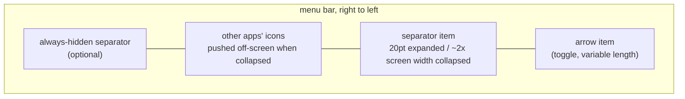
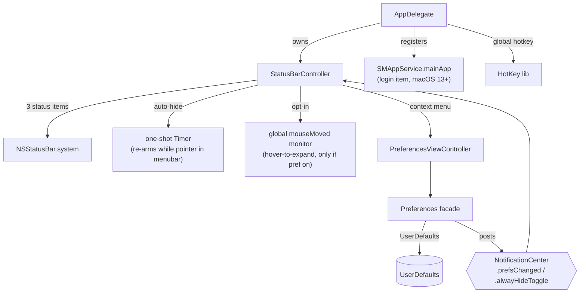

# Architecture

Hidden Bar is a single-process, sandboxed AppKit menubar utility (~1.5k lines of
Swift, one dependency: [HotKey](https://github.com/soffes/HotKey)). There is no
helper app, no daemon, no network. Everything happens inside three
`NSStatusItem`s and one window.

## The core trick

macOS offers no API to hide other apps' menubar icons. Hidden Bar fakes it with
geometry: a separator status item whose **length is inflated to roughly the
width of the widest attached screen**, shoving every icon to its left off-screen.
Collapsing and expanding is just flipping that length between ~20pt and the
inflated value.

Key consequences of this design:

- The menubar replicates on every display, so the collapse length derives from
  the **widest** screen (`NSScreen.screens`), never `NSScreen.main`, and is
  re-applied to the live item on `didChangeScreenParametersNotification`
  (display hot-plug).
- The length is bounded: `max(500, min(widestFrameWidth * 2, 10_000))`. macOS
  enforces a hard 10,000pt maximum on `NSStatusItem.length`.
- `isCollapsed` is derived state: `separator.length > 20`, deliberately not an
  equality check, so it survives the length being recomputed while collapsed.
- Icons macOS inserts to the LEFT of the separator (where new status items
  appear) are in the hidden zone by default; that is inherent to the trick.

## Topology

- **`AppDelegate`** (entry): registers default prefs, sets up the global hotkey,
  runs the one-shot legacy login-item migration, owns the `StatusBarController`.
  Global shortcuts live in `HotKeyRegistry` (keyed by the preference that stores
  each one, re-read on `.prefsChanged`); `ShortcutRecorderRow` is the one
  Settings control that records them.
- **`StatusBarController`** (the product, ~370 lines): the three status items,
  when to collapse/expand, auto-hide timer, interaction-awareness, hover-to-expand,
  self-restore of dragged-off items.
- **`MenuBarEngine`** (`Features/StatusBar/Engine/`): how hiding is achieved.
  The controller calls `collapse` / `expand` / `updateAlwaysHiddenSection` /
  `invalidateLayout` and never writes a status-item length itself.
  `MenuBarEngineFactory` is the one place that picks an engine for the running
  OS and build: `NativeVisibilityEngine` on macOS 27 and later in the direct
  build (`HIDDENBAR_NATIVE_VISIBILITY`), `LegacyLengthEngine` (the length trick
  below) everywhere else, the App Store build on any OS included.
- **`ShortcutRecorderRow`** and **`HotKeyRegistry`** (`Features/Settings`, `Models`):
  every global shortcut (expand/collapse, find a hidden icon, presentation mode)
  is a `Data` preference recorded by the one `ShortcutRecorderRow` and bound by
  the registry, which re-reads on `.prefsChanged`. The registry never imports the
  hot key library; `AppDelegate` supplies the Carbon binding. A recorder refuses
  a combination that is already another Hidden Bar shortcut and names that one.
- **`MenuBarItemCatalog`** (`Features/StatusBar/Layout`, direct build only): the
  list of menu-bar apps (bundle id, name, icon, section, first-seen time, running
  state) built from the engine's unrestricted reads plus the pinned-sections table.
  It posts `.menuBarCatalogChanged` and the arrivals of the latest read; macOS's own
  extras are left out. The pure merge and diff is `MenuBarCatalogState`. The palette,
  arrivals and the presentation picker all read from it; none adds a read of its own.
- **`Reveal`** (`Features/Reveal`): opt-in scroll, empty-click and shake gestures that
  show the hidden icons. `RevealGestures` is the pure recognizer (thresholds in
  `RevealTuning`), `RevealHitTester` tells empty bar from an icon through one
  Accessibility read at the pointer, and `RevealController` asks `StatusBarController`
  to expand. Global mouse and scroll monitors only, installed only while a pref is on.
- **`Palette`** (`Features/Palette`, direct build): the type-to-find panel.
  `PaletteModel` and `PaletteRanking` are pure; `PaletteController` owns the
  non-activating key panel, so typing needs no key monitor. Return runs a
  `PaletteRevealSession`, which mirrors the clock session: it allows one more bundle
  through `MenuBarEngine.allowTemporarily`, presses the icon, and puts the old list
  back when its menu closes, unless the user changed the bar meanwhile.
- **`Arrivals`** (`Features/Arrivals`, direct build): `ArrivalsInbox` is the pure
  decision (seen set, pending queue, answers, upgrade seeding, 24 hour lapse).
  `ArrivalsController` applies `newAppDefaultSection` to each catalog arrival once,
  through `PinnedSectionEdits.set`; Ask Me queues it in `arrivalsPending`, dots the
  arrow, and the prompt popover answers.
- **`Presentation`** (`Features/Presentation`, direct build): `PresentationState` is
  the pure state machine (manual or mirror cause, camera and microphone pause with a
  2.5 s quiet period). `PresentationController` owns the capsule status item and the
  panels; `DisplayMirroring` reads `CGDisplayIsInMirrorSet` from the screen-parameters
  notice. The engine holds one desired list (`hold(whenBar:)`) and one reconcile
  (`reconcileHold`), so a launch, a clock click or a re-activation never swaps the strict
  list back; a refused list fails open and a crash releases it.
- **`Preferences`** (facade enum): typed accessors over `UserDefaults`; setters
  post `NotificationCenter` notifications that the controller and prefs window
  observe. There is no other state store.
- **`PreferencesWindowController`**: the only window, built in code with
  a centered tab control and panes (`PreferencesViewController` is General; Appearance, Advanced
  and About sit in `Features/Settings` and `Features/About`), shown on demand
  from the context menu. `SettingsContext` carries the build, OS and status the
  panes branch on; `SettingsModel.swift` holds the AppKit-free decisions.

## Behavior layers on the core trick

| Layer | Mechanism | Cost when unused |
|---|---|---|
| Auto-hide | one-shot `Timer` after expand; at fire, if the pointer sits in any screen's menubar band (`visibleFrame.maxY ... frame.maxY`), it re-arms instead of collapsing | none (single point-in-rect check at fire) |
| Hover-to-expand (opt-in) | global `.mouseMoved` monitor + 0.5s dwell timer; installed while the `hoverToExpand` default is true (Preferences checkbox; installed or removed on change) | zero: monitor not installed |
| Self-restore | `isVisible = true` forced on our items at launch; Cmd-dragging them off otherwise bricks the app (its only UI is those items) | none |
| Always-hidden section | a second separator item; its own length games, gated by `alwaysHiddenSectionEnabled` | item not created |
| Reveal gestures (opt-in) | global scroll and mouse monitors; one Accessibility read at the pointer once a gesture is recognized | zero: no monitor with every reveal pref off |
| Find a hidden icon (opt-in) | one registered global shortcut; a non-activating panel over `MenuBarItemCatalog` | zero: no shortcut, no panel |
| Arrivals (opt-in Ask Me) | catalog arrival diff; one pref write per new app | none with Show It or Hide It beyond the write |
| Presentation mode (opt-in) | a strict held list in the native engine, a capsule status item, mirror and capture signals | zero: no capsule while off |

## Autostart

macOS 13+ `SMAppService.mainApp`: the app registers itself; the login item is
visible and revocable in System Settings > General > Login Items. On first
launch after upgrade, a one-shot migration deauthorizes the legacy
`com.dwarvesv.LauncherApplication` helper registration (the BTM database never
garbage-collects those; see Apple TN3111). The helper app itself is gone.

## Security posture

Sandboxed (`com.apple.security.app-sandbox`), hardened runtime, no network
entitlement, no file I/O, no IPC surface, no shell or subprocess use. The only
dependency is HotKey (a small Carbon `RegisterEventHotKey` wrapper) locked by
the committed `Package.resolved`. The opt-in hover monitor observes pointer
position only and discards event payloads. About-window links are hardcoded.
A full-tree audit (2026-06) scored 9/10 with hygiene-level findings only.

The above describes the App Store build. The direct build (target **Hidden Bar
Direct**, unsandboxed) additionally links [Sparkle](https://sparkle-project.org)
2 for self-update: it fetches one appcast from the GitHub release assets over
HTTPS and installs only archives whose EdDSA signature matches `SUPublicEDKey`.
No system profile is sent (Sparkle's `SUEnableSystemProfiling` stays off). The
App Store binary contains no Sparkle code, framework, or Info.plist keys; see
the RUNBOOK for how that split is built and checked.

## Known architectural limits

- **The notch**: hidden icons sit "under" the notch area on notched Macs; the
  trick cannot reveal them there. The real fix is a spillover/second-bar design
  (tracked in issues #357/#341/#148; candidate implementations in PRs #350/#358).
- **macOS 27**: the menu bar re-architecture in macOS 27
  (`NSMenuBarNavigationSceneExtension`) breaks length-inflation hiding entirely
  (issue #360). The direct build hides natively there (`NativeVisibilityEngine`,
  which reads the sections over Accessibility); the App Store build cannot,
  because the sandbox blocks those reads, and keeps `LegacyLengthEngine`, which
  does not hide on 27. The behavior of macOS 27's own overflow « (when items
  land in it, never behind the notch) is re-measured by
  [`scripts/overflow-probe`](../scripts/overflow-probe/README.md).
- **Other apps' open menus**: interaction-awareness is pointer-position-based;
  a pointer deep inside another app's open dropdown is below the menubar band,
  so the collapse can still fire there.
